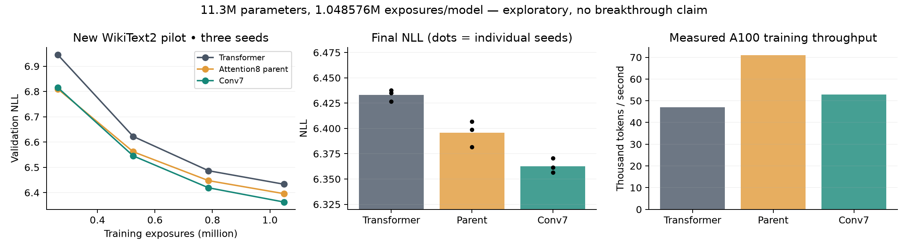
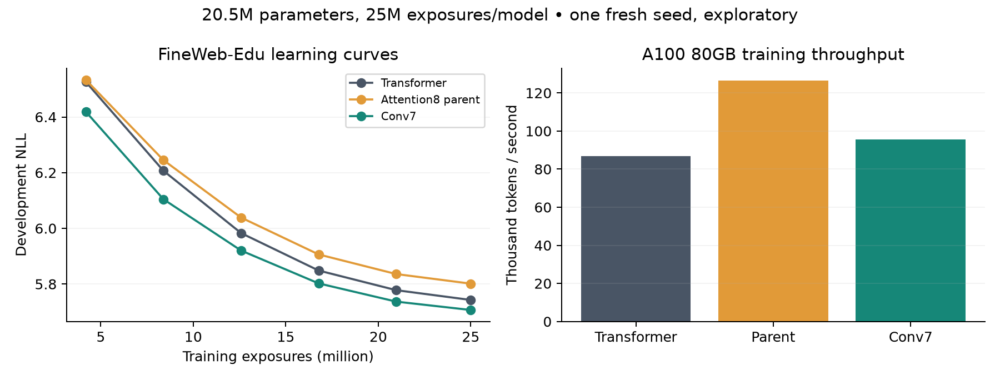
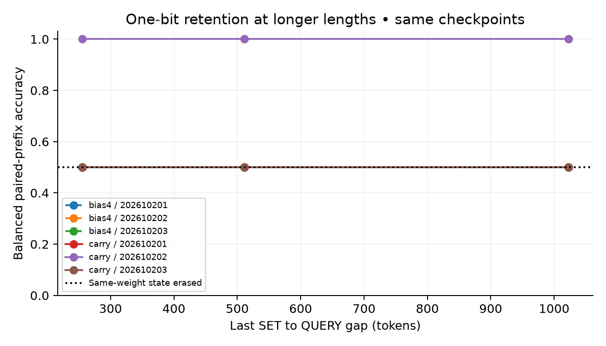

# Recorded experiment results

Completed result records: **50**. Every row is a recorded attempt, not an independent breakthrough confirmation.

| Track | Completed | Largest trained model | Largest per-model exposure count |
|---|---:|---:|---:|
| chm | 3 | 274,187 | 18,912 |
| chm_broad | 3 | 274,187 | 298,880 |
| conv7 | 9 | 11,295,120 | 1,048,576 |
| conv7_recovery | 3 | 20,484,672 | 24,997,888 |
| cpw | 4 | 13,123,072 | 2,560,000 |
| cpw_recovery | 1 | 13,123,072 | 51,200,000 |
| pgw | 9 | 20,354 | 278,400 |
| pgw_control | 3 | 176,801 | 10,879,680 |
| rlt | 9 | 27,712 | 1,363,200 |
| si | 6 | 62,366 | 10,240 |

## First language pilot

| Arm | NLL mean | Seed SD | Mean tokens/s |
|---|---:|---:|---:|
| Transformer | 6.433108 | 0.005670 | 46,972 |
| Attention8 parent | 6.395772 | 0.012759 | 70,991 |
| Conv7 | 6.362698 | 0.007111 | 52,835 |

Three wins from three initialization seeds do not establish a population-level significance claim; the one-sided sign-test probability under equal chances is1/8. The corpus and development evaluation remain shared.

## Longer screens and diagnostics

- **conv7-recovery-w192-attention8-202610262:** NLL 5.801374, 126,578 tok/s, 24,997,888 exposures; one seed.
- **conv7-recovery-w192-conv7-202610262:** NLL 5.706767, 95,699 tok/s, 24,997,888 exposures; one seed.
- **conv7-recovery-w192-transformer-202610262:** NLL 5.742762, 86,932 tok/s, 24,997,888 exposures; one seed.
- **cpw-recovery-transformer-202610261:** per-delay accuracy [0.013671875, 0.033203125, 0.021484375, 0.041015625]; all-four 0.0000; 51,200,000 exposures.
- **rlt-bias4-202610201:** retention pass False; gap127 accuracy 0.5508 (class0 0.6719, class1 0.4297).
- **rlt-bias4-202610202:** retention pass False; gap127 accuracy 0.5000 (class0 0.0000, class1 1.0000).
- **rlt-bias4-202610203:** retention pass False; gap127 accuracy 0.5000 (class0 0.1641, class1 0.8359).
- **rlt-carry-202610201:** retention pass True; gap127 accuracy 1.0000 (class0 1.0000, class1 1.0000).
- **rlt-carry-202610202:** retention pass True; gap127 accuracy 1.0000 (class0 1.0000, class1 1.0000).
- **rlt-carry-202610203:** retention pass False; gap127 accuracy 0.5000 (class0 0.0000, class1 1.0000).
- **rlt-reset-202610201:** retention pass False; gap127 accuracy 0.5000 (class0 0.0000, class1 1.0000).
- **rlt-reset-202610202:** retention pass False; gap127 accuracy 0.5000 (class0 0.0000, class1 1.0000).
- **rlt-reset-202610203:** retention pass False; gap127 accuracy 0.5000 (class0 0.0000, class1 1.0000).

### FineWeb development gate

Conv7 minus Transformer NLL: **-0.035995**; training throughput ratio: **1.1008**; parent minus Conv7 NLL: **0.094607**. Frozen endpoint quality/speed/mechanism gates passed: **True**. This is one-seed development evidence, not an independent replicated breakthrough.

## PGW deeper-control calibration

Fresh three-layer 176,801-parameter controls, answer CE alone, 5,000 updates. A passing control is required before the conditional native-hybrid extension. These controls have a different parameter/compute budget from the native PGW; this is learnability work, not a superiority comparison.

| Seed | Delay | Present answer accuracy | Missing rejection | NLL |
|---|---:|---:|---:|---:|
| 202610231 | 1 | 0.0000 | 1.0000 | 1.673896 |
| 202610231 | 2 | 0.0000 | 1.0000 | 1.707250 |
| 202610231 | 4 | 0.0000 | 1.0000 | 1.694685 |
| 202610232 | 1 | 0.0000 | 1.0000 | 1.667087 |
| 202610232 | 2 | 0.0000 | 1.0000 | 1.656886 |
| 202610232 | 4 | 0.0000 | 0.9889 | 1.685094 |
| 202610233 | 1 | 0.0000 | 1.0000 | 1.689119 |
| 202610233 | 2 | 0.0000 | 1.0000 | 1.647685 |
| 202610233 | 4 | 0.0000 | 0.9667 | 1.653471 |

## CHM optimizer-unseen entity diagnostic

Inference only, all 63 native TRAIN entities excluded from the capacity optimizer. Eight rotations per positive entity are correlated. Reserved DEVELOPMENT/TEST remain unopened. Values below are initialization-seed means and ranges, not confidence intervals.

| Family | Mean answer accuracy | Seed range | Mean abstention |
|---|---:|---:|---:|
| direct | 0.0780 | 0.0079–0.1607 | 0.5397 |
| overwrite | 0.1534 | 0.1012–0.2123 | 0.1918 |
| two_hop | 0.0939 | 0.0655–0.1349 | 0.1369 |
| no_match | 0.4815 | 0.0476–0.8254 | 0.4815 |

## CHM broad TRAIN / first reserved DEVELOPMENT study

New initialization/data-order protocol, 4,096 updates across all 64 TRAIN entities. Native DEVELOPMENT: 16 independent entities/family; native TEST remains closed. This flat Transformer-based pointer has extra gold-address training supervision; no superiority or hierarchical acceleration claim.

| Seed | Family | TRAIN answer accuracy | DEVELOPMENT answer accuracy | DEV first source | DEV payload source | DEV abstention |
|---|---|---:|---:|---:|---:|---:|
| 202610271 | direct | 0.3594 | 0.1953 | 0.3203 | 0.2031 | 0.1328 |
| 202610271 | overwrite | 0.3672 | 0.1797 | 0.1016 | 0.1797 | 0.0000 |
| 202610271 | two_hop | 0.3516 | 0.1016 | 0.3594 | 0.1016 | 0.0000 |
| 202610271 | no_match | 0.5938 | 0.0625 | 0.0000 | 0.0000 | 0.0625 |
| 202610272 | direct | 0.8145 | 0.0391 | 0.1172 | 0.1250 | 0.3906 |
| 202610272 | overwrite | 0.9238 | 0.2188 | 0.0625 | 0.2188 | 0.0000 |
| 202610272 | two_hop | 0.8145 | 0.1406 | 0.7500 | 0.1406 | 0.0000 |
| 202610272 | no_match | 0.9844 | 0.5625 | 0.0000 | 0.0000 | 0.5625 |
| 202610273 | direct | 0.7383 | 0.0312 | 0.1406 | 0.0391 | 0.3750 |
| 202610273 | overwrite | 0.7930 | 0.1641 | 0.2500 | 0.1641 | 0.0000 |
| 202610273 | two_hop | 0.6855 | 0.0547 | 0.7188 | 0.0547 | 0.0000 |
| 202610273 | no_match | 0.7656 | 0.3125 | 0.0000 | 0.0000 | 0.3125 |

## RLT longer retention and causal erasure

No additional optimization. New paired noise prefixes, lengths beyond the training maximum of 128. Opposite-label pairs share every token after the initial SET; same-weight state erasure must give 50% balanced accuracy. This tests one-bit retention, not general language quality.

| Arm | Seed | Gap | Carry | Accuracy | Class 0 | Class 1 |
|---|---:|---:|---|---:|---:|---:|
| bias4 | 202610201 | 255 | True | 0.5000 | 0.6641 | 0.3359 |
| bias4 | 202610201 | 511 | True | 0.5000 | 0.6719 | 0.3281 |
| bias4 | 202610201 | 1023 | True | 0.5000 | 0.6406 | 0.3594 |
| bias4 | 202610201 | 255 | False | 0.5000 | 0.5781 | 0.4219 |
| bias4 | 202610201 | 511 | False | 0.5000 | 0.5312 | 0.4688 |
| bias4 | 202610201 | 1023 | False | 0.5000 | 0.4844 | 0.5156 |
| bias4 | 202610202 | 255 | True | 0.5000 | 0.0000 | 1.0000 |
| bias4 | 202610202 | 511 | True | 0.5000 | 0.0000 | 1.0000 |
| bias4 | 202610202 | 1023 | True | 0.5000 | 0.0000 | 1.0000 |
| bias4 | 202610202 | 255 | False | 0.5000 | 1.0000 | 0.0000 |
| bias4 | 202610202 | 511 | False | 0.5000 | 1.0000 | 0.0000 |
| bias4 | 202610202 | 1023 | False | 0.5000 | 1.0000 | 0.0000 |
| bias4 | 202610203 | 255 | True | 0.5000 | 0.2031 | 0.7969 |
| bias4 | 202610203 | 511 | True | 0.5000 | 0.2656 | 0.7344 |
| bias4 | 202610203 | 1023 | True | 0.5000 | 0.1797 | 0.8203 |
| bias4 | 202610203 | 255 | False | 0.5000 | 0.1562 | 0.8438 |
| bias4 | 202610203 | 511 | False | 0.5000 | 0.1875 | 0.8125 |
| bias4 | 202610203 | 1023 | False | 0.5000 | 0.1484 | 0.8516 |
| carry | 202610201 | 255 | True | 0.5000 | 0.0000 | 1.0000 |
| carry | 202610201 | 511 | True | 0.5000 | 0.0000 | 1.0000 |
| carry | 202610201 | 1023 | True | 0.5000 | 0.0000 | 1.0000 |
| carry | 202610201 | 255 | False | 0.5000 | 0.0000 | 1.0000 |
| carry | 202610201 | 511 | False | 0.5000 | 0.0000 | 1.0000 |
| carry | 202610201 | 1023 | False | 0.5000 | 0.0000 | 1.0000 |
| carry | 202610202 | 255 | True | 1.0000 | 1.0000 | 1.0000 |
| carry | 202610202 | 511 | True | 1.0000 | 1.0000 | 1.0000 |
| carry | 202610202 | 1023 | True | 1.0000 | 1.0000 | 1.0000 |
| carry | 202610202 | 255 | False | 0.5000 | 0.0000 | 1.0000 |
| carry | 202610202 | 511 | False | 0.5000 | 0.0000 | 1.0000 |
| carry | 202610202 | 1023 | False | 0.5000 | 0.0000 | 1.0000 |
| carry | 202610203 | 255 | True | 0.5000 | 0.0000 | 1.0000 |
| carry | 202610203 | 511 | True | 0.5000 | 0.0000 | 1.0000 |
| carry | 202610203 | 1023 | True | 0.5000 | 0.0000 | 1.0000 |
| carry | 202610203 | 255 | False | 0.5000 | 1.0000 | 0.0000 |
| carry | 202610203 | 511 | False | 0.5000 | 1.0000 | 0.0000 |
| carry | 202610203 | 1023 | False | 0.5000 | 1.0000 | 0.0000 |

## Incomplete / error records

No started attempt currently lacks a terminal RESULT in this local snapshot; inspect error and remote-worker records separately.
