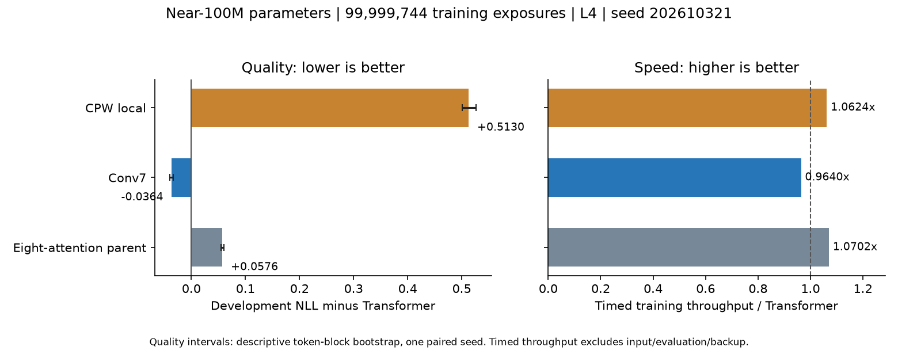

# Current allocation while the larger study runs

No architecture has demonstrated a breakthrough. This phase completed new
failure probes and trained planning/readout repairs. All four near100M language
arms reached99,999,744 training exposures on one L4. Conv7 passed the frozen
100M gate and advances with its controls toward300M; CPW local failed and stops
at100M. Longer Conv7 confirmation and terminal benchmarks remain pending; this
is not a completed2B-token study.

| Architecture | Current decision | New measured evidence |
|---|---|---|
| Conv7 | Advance to300M training exposures with both controls | At99,999,744 exposures, NLL4.484530 versus Transformer4.520965 and parent4.578586. Timed training throughput is0.9640x Transformer on this L4: a quality gain at matched tokens with3.6% lower throughput. One paired seed; no equal-compute or breakthrough claim. |
| CPW | Stop scaling this local configuration after100M; hold AFM/world claims | NLL5.034013 versus Transformer4.520965, despite1.0624x timed throughput; the frozen continuation gate fails. Terminal test NLL5.051848. Its current-token+15-token lookback is a structural limit, but this experiment does not isolate that as the entire cause or test AFM. Earlier corrected-binding controls failed to learn reliably. |
| PGW | Drop current workspace scaling; repair allocation first | Three checkpoint traces send93–99% of writes to one of four slots. Direct target-value contributions attenuate. This is a measured bottleneck and repair hypothesis; keys/routing remain other information paths. Historical language gains lacked a carry-specific benefit, while new retrieval controls remain invalid. |
| CHM | Drop current pointer prototype as a large-training target | On all three broad-trained checkpoints, gold first-hop context barely changes poor development payload accuracy. Unseen-identity/second-hop readout and missing-fact rejection need repair. The prototype is flat attention with a soft context path, so it has not established hierarchical acceleration. Native TEST stays closed. |
| Bounded RLT branch | Hold large language training; the tested repairs are insufficient | Native and public-gate-prior models each pass only1/3 full length gates. A66-parameter frozen-state probe recovers the first-SET task through1024 in all3 native seeds, showing stored information survives. Every new extrapolation/overwrite follow-up gate fails. Neither repair is a robust general memory solution; the published nonlinear RLT is a separate un-reproduced model. |
| SI Original V2 | Repair memory revision/persistence, then cheap multistep and continual-task validation; hold full-system scaling | Planning repair reaches100% on a finite task already solved by the direct policy. New native memory diagnostics retain A across B/C, but all8 revised A facts retrieve old deltas in all3 seeds (8/16 current A associations correct). Native persistent import restores0/56 replay records; an explicit full checkpoint restores56/56. These are concrete component repair targets, without a demonstrated continual-learning or multistep decision advantage. |

The completed L4 scientific100M stage (one paired seed202610321) is:

| Model | Actual parameters | Training exposures | Development NLL | Timed tokens/s | Decision |
|---|---:|---:|---:|---:|---|
| Transformer |99,837,440|99,999,744|4.520965|29,926|Continue as control|
| Eight-attention parent |99,558,912|99,999,744|4.578586|32,028|Continue as Conv7 control|
| Conv7 |99,616,272|99,999,744|4.484530|28,850|Pass; advance to300M|
| CPW local |99,674,432|99,999,744|5.034013|31,795|Fail; stop at100M|

Conv7-minus-Transformer NLL is-.036435; its descriptive paired token-block
bootstrap interval is[-.039516,-.033352]. Blocks/documents are dependent and
this interval is not independent-seed confirmation. The Conv7 parent benefit
is.094056. CPW's+.513048 loss gap exceeds the frozen gate, despite a6.24% timed
throughput gain. This is a stopping decision for one local architecture/recipe,
not a proof that all CPW variants are unworkable. Test loss is opened once at
terminal selection; the Transformer is still training, so no matched terminal
test comparison is available for CPW. See L4_RESULTS.md and L4_SUMMARY.json.

The separate interrupted A100 controls were:

| Model | Parameters | Training exposures | Development NLL | Timed training tokens/s |
|---|---:|---:|---:|---:|
| Full attention |99,837,440|99,999,744|4.513550|100,177|
| Eight-attention parent |99,558,912|99,999,744|4.571129|113,396|

These are one-seed prefixes of a fixed2B-horizon schedule. The full-attention
optimizer checkpoint is backed up and SHA-verified. The parent metric/hash is
saved, but its weights were not exported before the runtime disappeared.
Conv7/CPW outcomes from that assignment are unknown. See INTERRUPTED_PANEL.json.

A100 reassignment returned503; the fresh L4 study uses new paired seed202610321
for all four arms on the same device. It retains the old trial separately and
will report L4 cost comparisons within that trial. It advances only after an
exclusive exposure reservation is saved locally, and after every short segment
the full optimizer checkpoint is downloaded and verified before proceeding.
Lost reserved segments are conservatively charged before resumption. The
four100M scientific L4 checkpoints are verified locally, including full
optimizer/RNG state. Midpoint binaries can be superseded after a newer verified
backup; all scientific milestone checkpoints and manifests are retained.

On21 October the lost L4 runtime was recovered from verified full states at
233,349,120 inputs for Transformer and211,124,224 for parent/Conv7. The parent's
unfinished22,224,896-position reservation is conservatively charged once. An
initial restore VM disappeared before training release (zero additional inputs).
An unpublished draft-release cache then enabled all four exact optimizer files
to download and verify in290 seconds. Same-seed training resumed on another L4,
with identical source/data hashes and PyTorch version. The common final committed
ceiling is1,977,769,984 without further losses; parent committed inputs plus its
lost charge remain below2B. See L4_RECOVERY_20261021.json and RESTORE_TRANSPORT.md.

The prospective100M/300M/1B/2B gates determine whether further language training
is justified. CPW terminal NLL is complete; remaining terminal NLL, LAMBADA,
PIQA and inference measurements are pending. Those benchmarks will label
different terminal training budgets explicitly.
There is a quiet follow-up in this chat to finish collection, audits and the
six-architecture verdict. Thresholds and sources were frozen before candidate
endpoints; unsuccessful and unknown attempts remain in the record.

Continual-learning utility remains unvalidated. SI's new frozen-representation
component study retains A associations across B/C, but fails all8 changing-fact
updates per seed and confirms missing native replay persistence. Its successful
head-calibration study disabled memory/fast updates. A full A/B/C task-acquisition
and forgetting comparison remains unperformed. See CONTINUAL_LEARNING_STATUS.md.

Read RESULTS.md for measurements, EXECUTION_NOTES.md for limits, and the
prospective protocols for exact budgets. All currently recorded runs remain
below100M actual parameters and2B training exposures per lineage. Hardware-only
nearest-rounding Conv7 was rejected by the parameter guard before any update.
